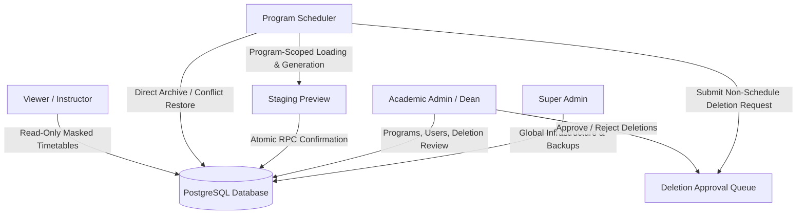
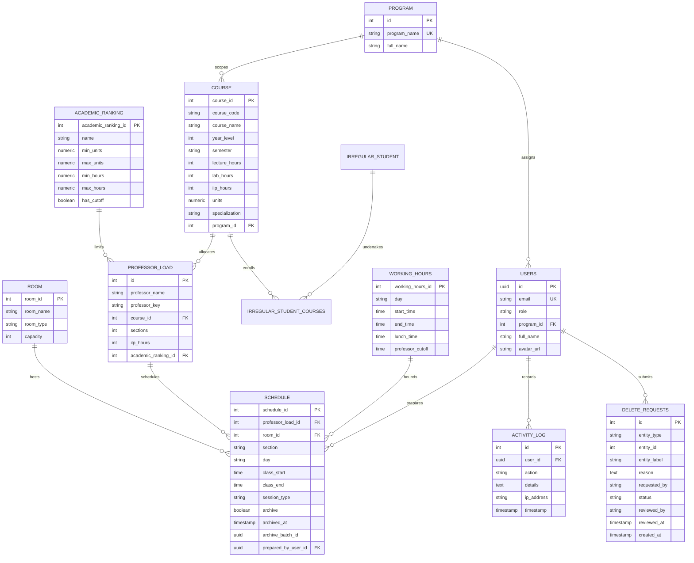
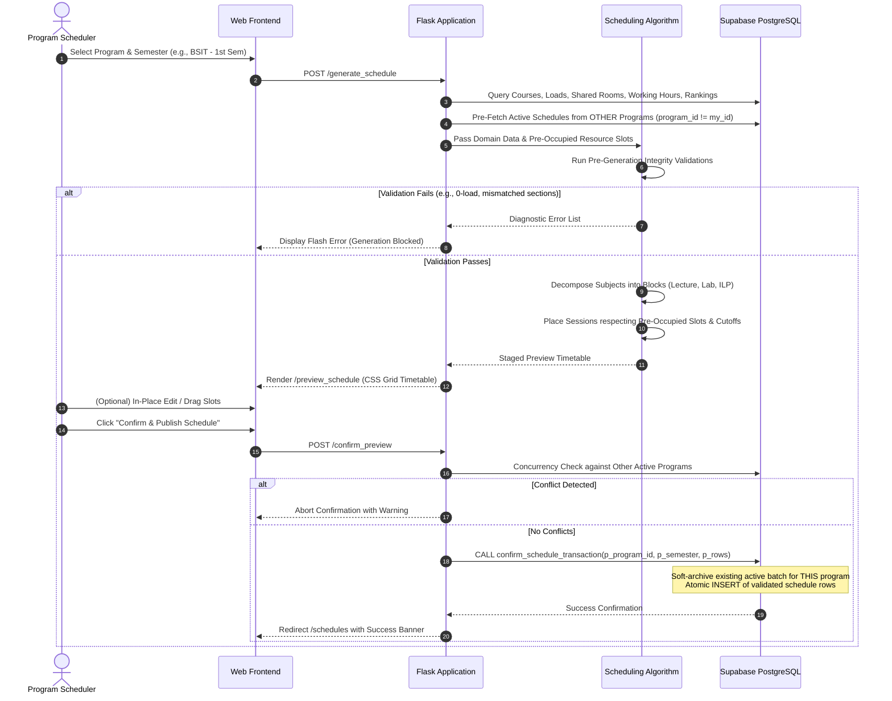
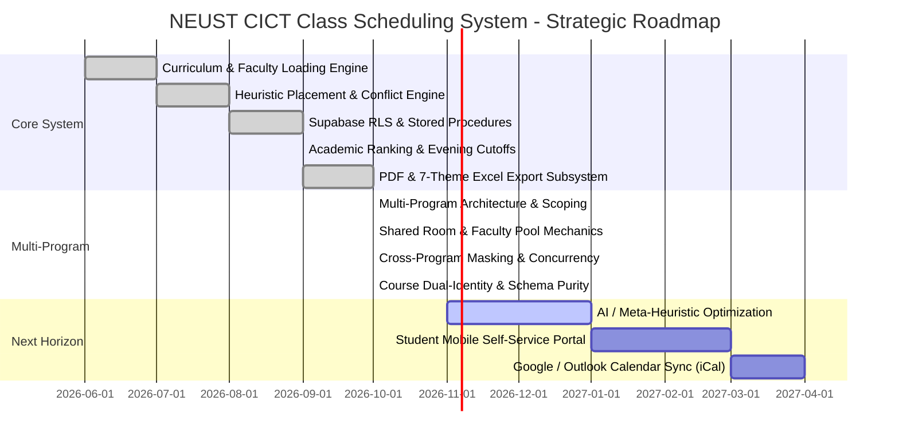

# Product Requirements Document (PRD)

## University Class Scheduling and Room Allocation System with Conflict Detection

| Document Version | 3.2.0 (Enterprise Multi-Program Production Edition) |
| :--- | :--- |
| **System Status** | Production / Active Multi-Program Deployment |
| **Release Date** | October 11, 2026 |
| **Primary Authors** | Capstone Systems Architecture & Engineering Team |
| **Target Institution** | Nueva Ecija University of Science and Technology (NEUST) — College of Information and Communications Technology (CICT) |
| **Supported Academic Programs** | BSIT (Information Technology), BSDS (Data Science), BSCS (Computer Science) |
| **Repository** | [ClassScheduling](file:///c:/Users/Administrator/Oct11Capstone/ClassScheduling) |

---

## Table of Contents

1. [Executive Summary & System Overview](#1-executive-summary--system-overview)
   - [1.1 Purpose & Vision](#11-purpose--vision)
   - [1.2 Institutional Context: NEUST CICT](#12-institutional-context-neust-cict)
   - [1.3 Problem Statement & Root Cause Analysis](#13-problem-statement--root-cause-analysis)
   - [1.4 System Scope & Operational Boundaries](#14-system-scope--operational-boundaries)
   - [1.5 Key Performance Indicators (KPIs)](#15-key-performance-indicators-kpis)
2. [User Personas, Roles & Access Control (RBAC)](#2-user-personas-roles--access-control-rbac)
   - [2.1 User Personas](#21-user-personas)
   - [2.2 Permissions Matrix & Multi-Program Scoping](#22-permissions-matrix--multi-program-scoping)
   - [2.3 Row Level Security (RLS) & Session Guard Topology](#23-row-level-security-rls--session-guard-topology)
3. [System Architecture & Technology Stack](#3-system-architecture--technology-stack)
   - [3.1 High-Level Architecture Topology](#31-high-level-architecture-topology)
   - [3.2 Component & Technology Matrix](#32-component--technology-matrix)
4. [Data Models & Database Architecture](#4-data-models--database-architecture)
   - [4.1 Entity Relationship Diagram (ERD)](#41-entity-relationship-diagram-erd)
   - [4.2 Comprehensive Data Dictionary](#42-comprehensive-data-dictionary)
   - [4.3 Dynamic Relational Views](#43-dynamic-relational-views)
5. [Core Functional Modules & Detailed Specifications](#5-core-functional-modules--detailed-specifications)
   - [5.1 Academic Programs Administration](#51-academic-programs-administration)
   - [5.2 Faculty Ranks & Workload Capacities](#52-faculty-ranks--workload-capacities)
   - [5.3 Course Catalog & Dual-Identity Framework (`course_code` & `course_name`)](#53-course-catalog--dual-identity-framework-course_code--course_name)
   - [5.4 Shared Faculty Loading & Intelligent Importer Subsystem](#54-shared-faculty-loading--intelligent-importer-subsystem)
   - [5.5 Shared Facilities & Physical Room Inventory](#55-shared-facilities--physical-room-inventory)
   - [5.6 Institutional Working Hours & Daily Evening Cutoffs](#56-institutional-working-hours--daily-evening-cutoffs)
   - [5.7 Automated Schedule Generation Engine](#57-automated-schedule-generation-engine)
   - [5.8 Multi-Dimensional Conflict Detection Engine](#58-multi-dimensional-conflict-detection-engine)
   - [5.9 Staging Preview, In-Place Editing & Atomic Transactional Commitment](#59-staging-preview-in-place-editing--atomic-transactional-commitment)
   - [5.10 Timetable Visualization & Cross-Program Privacy Masking](#510-timetable-visualization--cross-program-privacy-masking)
   - [5.11 Schedule Archiving & Conflict-Protected Restoration Subsystem](#511-schedule-archiving--conflict-protected-restoration-subsystem)
   - [5.12 Irregular Student Timetable Builder](#512-irregular-student-timetable-builder)
   - [5.13 Institutional Document Export Subsystem (Folio PDF & Themed Excel)](#513-institutional-document-export-subsystem-folio-pdf--themed-excel)
   - [5.14 Two-Phase Deletion Request & Approval Workflow](#514-two-phase-deletion-request--approval-workflow)
   - [5.15 Disaster Recovery, Backup & Atomic Restoration Subsystem](#515-disaster-recovery-backup--atomic-restoration-subsystem)
6. [Business Rules, Validations & Edge Case Logic](#6-business-rules-validations--edge-case-logic)
7. [Non-Functional Requirements (NFRs)](#7-non-functional-requirements-nfrs)
8. [Deployment, Environment & Operational Guidelines](#8-deployment-environment--operational-guidelines)
9. [Future Strategic Roadmap](#9-future-strategic-roadmap)

---

## 1. Executive Summary & System Overview

### 1.1 Purpose & Vision
The **University Class Scheduling and Room Allocation System with Conflict Detection** is an automated academic timetable optimization, faculty workload allocation, and facility management platform. Built specifically for collegiate environments, it resolves the NP-hard combinatorial challenge of harmoniously assigning student cohorts, faculty members, specialized classrooms, computer laboratories, and timeslots across multiple degree programs without resource contention.

### 1.2 Institutional Context: NEUST CICT
The system is tailored for the **College of Information and Communications Technology (CICT)** at the **Nueva Ecija University of Science and Technology (NEUST)**. CICT operates multiple undergraduate degree programs—primarily the Bachelor of Science in Information Technology (**BSIT**), Bachelor of Science in Data Science (**BSDS**), and Bachelor of Science in Computer Science (**BSCS**)—which share common computer laboratories, general classrooms, and a multidisciplinary faculty pool.

The system incorporates official university standards:
* Official NEUST CICT document letterhead with dual institutional seals (**Bagong Pilipinas** and **NEUST Centennial Seal**), vertical divider, and college crest.
* Philippine Legal / Folio ($8.5'' \times 13''$) landscape print formatting.
* Mandatory 3-tier academic signatory authorization:
  1. **Prepared by:** Program Curriculum Scheduler
  2. **Verified by:** Department Chairperson
  3. **Approved by:** College Dean

### 1.3 Problem Statement & Root Cause Analysis
Prior manual and fragmented spreadsheet-based scheduling suffered from severe institutional friction:
1. **Physical Resource Contention:** Specialized computer laboratories (e.g., Cisco Lab, Multimedia Lab, Database Lab) and lecture halls were repeatedly double-booked across autonomous departments sharing the same building.
2. **Faculty Overload & Rank Violations:** Instructors exceeded rank-mandated unit caps ($18.0$–$24.0$ units) or teaching hours ($40.0$ hrs), while full-time faculty were accidentally assigned past contractual evening cutoffs (Monday 16:00, Tuesday–Friday 17:00).
3. **Cross-Program Faculty Collisions:** Multidisciplinary professors teaching across degree programs (e.g., Discrete Mathematics in BSCS and Web Systems in BSIT) experienced overlapping timeslot allocations.
4. **Pedagogical Fatigue & Clustering:** Student cohorts were subjected to irregular spacing, such as $4$ consecutive lecture blocks in a single day, missing lunch breaks, or exceeding weekly late-session allowances.
5. **Specialization Elective Clashes:** In specialized academic terms (Year 3 Semester 2 through Year 4), cohort tracks (Database Systems, Web Systems, Networking) clashed with institutional general education courses.
6. **Administrative Deadlocks:** Timetable drafting consumed $2$–$4$ weeks per semester. A single downstream modification cascaded into pervasive schedule collapses.

### 1.4 System Scope & Operational Boundaries
* **Multi-Program Architecture:** Autonomous degree programs (e.g., BSIT, BSDS, BSCS) administer independent curricula while drawing from a shared institution-wide pool of physical classrooms and faculty instructors.
* **Academic Cadence:** Semester-based scheduling cycle (`1st Semester` and `2nd Semester`).
* **Session Typologies:**
  1. `Lecture`: Theory sessions assigned strictly to physical lecture rooms.
  2. `Laboratory`: Hands-on practical sessions assigned strictly to specialized laboratory facilities.
  3. `ILP` (Instructional Laboratory Period / Practice): 1-hour supplementary hands-on sessions assigned to lecture rooms.
* **Core Operating Paradigm:** **Faculty Load-Driven Scheduling**. Schedules are generated strictly from approved course assignments in `professor_load`. Classes are never scheduled without an explicit faculty loading allocation.

### 1.5 Key Performance Indicators (KPIs)
* **Generation Speed:** Complete multi-year program schedule generation ($40$–$80$ sections) executes in **$< 5$ seconds**.
* **Zero Conflict Guarantee:** $100\%$ mathematical elimination of room double-bookings, professor overlaps, section collisions, and lunch hour encroaching upon schedule confirmation.
* **Cross-Program Isolation & Privacy:** $100\%$ prevention of cross-program resource collisions while maintaining privacy-preserving timetable masking (`"Occupied - <Program>"` and `"Busy - <Program> (<Course>)"`).
* **Data Integrity:** Zero data loss via atomic PostgreSQL stored procedures (`confirm_schedule_transaction`, `restore_database_json`), non-destructive soft-archiving, and full schema evolution backwards compatibility.

---

## 2. User Personas, Roles & Access Control (RBAC)

The system enforces strict Role-Based Access Control (RBAC) integrated with PostgreSQL Row Level Security (RLS) and Flask session authorization decorators (`@roles_required`, `@login_required`).



### 2.1 User Personas

#### 1. Super Admin
* **Profile:** Institutional IT Administrator / System Architect.
* **Jurisdiction:** Global, unconstrained access across all programs, users, system settings, database backups, and restoration workflows. Can bypass two-phase deletion approvals.

#### 2. Academic Admin / College Dean
* **Profile:** College Dean, Associate Dean, or Academic Chairperson.
* **Jurisdiction:** Manages academic programs (`/programs`), user accounts (`/users`), academic ranking limits (`/ranking`), room inventory (`/rooms`), and reviews/approves pending deletion requests. Has global visibility across all programs with filter dropdowns.

#### 3. Program Scheduler
* **Profile:** Designated Faculty Scheduler or Curriculum Coordinator for a specific academic program (e.g., BSIT Scheduler, BSDS Scheduler).
* **Jurisdiction:** Scoped strictly to their assigned `program_id`. Manages program courses, assigns faculty loads, triggers schedule generation, edits draft sessions, confirms active schedules, and archives/restores active batches directly. Cross-program URL manipulation returns HTTP 403 Forbidden.

#### 4. Viewer
* **Profile:** Students, Faculty, and General Staff (Default role for all new self-signups).
* **Jurisdiction:** Strictly read-only access to schedules only. Can ONLY view Section Schedule (`/schedules`) and Room Schedule (`/room_schedule`). Viewers do NOT have access to export features (Excel and PDF exports are restricted to Admin and Scheduler roles). Viewers have no program assignment (`program_id = NULL`) and can select and view active schedules across all programs with zero edit/delete/archive controls. Viewers must NOT see or access Professor Schedules, Faculty Loading, Management pages, or System Administration.
*(Superseded Note: The earlier specification granting Viewers a personal faculty loading summary or professor schedule access, as well as export features, is formally superseded. Viewer = Section Schedule + Room Schedule read-only view).*

### 2.2 Permissions Matrix & Multi-Program Scoping

| System Capability | Super Admin | Academic Admin / Dean | Program Scheduler | Viewer | Scoping Mechanism |
| :--- | :---: | :---: | :---: | :---: | :--- |
| **Manage Programs (`/programs`)** | Full CRUD | Full CRUD | None | None | Admin-only route guard |
| **Manage Users & Role Assignment** | Full CRUD | Full CRUD | None | None | Admin-only route guard |
| **Academic Rankings Config** | Full CRUD | Full CRUD | View Only | None (HTTP 403) | Global institutional policy |
| **Course Catalog Management** | Full CRUD | Full CRUD | Scoped CRUD | None (HTTP 403) | Filtered by `course.program_id` |
| **Faculty Load Allocation** | Full CRUD | Full CRUD | Program-Scoped | None (HTTP 403) | Scoped by `course.program_id` |
| **Rooms & Facilities Pool** | Full CRUD | Full CRUD | Edit / Del Req | None (HTTP 403) | Shared institutional pool |
| **Institutional Working Hours** | Full CRUD | Full CRUD | View Only | None (HTTP 403) | Global institutional policy |
| **Automated Schedule Generation** | Global | Global | Program-Scoped | None (HTTP 403) | Scoped by `session.program_id` |
| **Staging Preview & Confirmation** | Global | Global | Program-Scoped | None (HTTP 403) | Concurrency-protected |
| **Archive Active Schedule** | Global | Global | Scoped Direct Action | None (HTTP 403) | Direct archive without deletion request |
| **Archive Restoration** | Global | Global | Scoped Direct Action | None (HTTP 403) | Blocked if active schedule exists or conflicts occur |
| **Permanent Delete Archive** | Global | Global | None (HTTP 403) | None (HTTP 403) | Admin-only direct action (RLS: archive=true) |
| **Section Schedule View** | All Programs | All Programs | Scoped to Assigned Prog | All Active Programs (Read-Only) | Timetable view |
| **Room Schedule View** | All Programs | All Programs | Masked (`Occupied - <Prog>`) | Masked / Read-Only | Program-aware masking |
| **Professor Schedule View** | All Programs | All Programs | Masked (`Busy - <Prog>`) | None (HTTP 403) | Professor timetable & workload guard |
| **Schedule Exports (Excel & PDF)**| All Programs | All Programs | Scoped to Assigned Prog | None (HTTP 403) | Export route guard & UI hidden |
| **Deletion Approval Queue** | Full Control | Full Control | Submit Only | None (HTTP 403) | Non-schedule entities (Courses, Rooms, etc.) |
| **Database Backup & Restore** | Yes | Yes | None | None (HTTP 403) | Admin-only route guard |

### 2.3 Row Level Security (RLS) & Session Guard Topology
1. **Public/Anon Key Architecture:** The application communicates with Supabase strictly via `SUPABASE_ANON_KEY` (or `SUPABASE_PUBLISHABLE_KEY`) carrying the user's authenticated session JWT.
2. **Zero Service-Role Exposure:** The `service_role` secret key is strictly prohibited and excluded from application code.
3. **Database Security Functions:** Helper functions `public.get_user_role()` and `public.get_user_program_id()` evaluate session claims inside PostgreSQL RLS policies to enforce program scoping at the database layer.

---

## 3. System Architecture & Technology Stack

### 3.1 High-Level Architecture Topology

```mermaid
flowchart TB
    subgraph Client [Client Presentation Tier]
        Browser["Modern Web Browser (Chrome, Firefox, Edge, Safari)"]
    end

    subgraph AppServer [Application Server - Python 3.11+ / Flask 3.0]
        RouteAuth["Flask Core & RBAC Decorators (@roles_required)"]
        GenEngine["Automated Schedule Generation Engine"]
        ConflictEngine["Multi-Dimensional Conflict Detection Engine"]
        Importer["Intelligent Load Importer (Levenshtein Fuzzy Matcher)"]
        ExportPDF["ReportLab 4.0+ Folio Vector PDF Engine"]
        ExportXLSX["openpyxl 3.1+ 7-Theme Excel Engine"]
        Templates["Jinja2 Server-Rendered UI with Glassmorphism"]
    end

    subgraph Persistence [Persistence & Security Tier - Supabase / PostgreSQL 15+]
        Auth["Supabase Authentication (JWT & Session Token)"]
        RLS["PostgreSQL Row Level Security (RLS) Policies"]
        Views["Security-Invoker Views (schedule_with_semester)"]
        Tables[("Relational Database Schema (Normalized)")]
        RPC["PostgreSQL Stored Procedures (confirm_schedule, restore_json)"]
    end

    Browser <-->|HTTP / HTTPS (HTML5, CSS3, JSON)| RouteAuth
    RouteAuth --> GenEngine
    RouteAuth --> ConflictEngine
    RouteAuth --> Importer
    RouteAuth --> ExportPDF
    RouteAuth --> ExportXLSX
    RouteAuth --> Templates

    AppServer <-->|PostgREST / Supabase Python SDK (JWT Auth)| Auth
    Auth --- RLS
    RLS --- Views
    Views --- Tables
    RouteAuth <-->|Remote Procedure Calls| RPC
    RPC --- Tables
```

### 3.2 Component & Technology Matrix

| Architectural Layer | Technology Choice | Operational Rationale |
| :--- | :--- | :--- |
| **Backend Framework** | Python 3.11+ / Flask 3.0 | Lightweight, robust web runtime enabling rapid execution of combinatorial placement algorithms and mathematical heuristics. |
| **Database Engine** | PostgreSQL 15+ (Supabase) | ACID-compliant relational persistence, JSONB document storage, strict foreign key constraints, composite partial indexes, and PL/pgSQL stored procedures. |
| **Data Access & Security** | Supabase Python SDK / PostgREST | Client execution authenticated via user JWTs using `SUPABASE_ANON_KEY`; PostgreSQL Row Level Security enforces multi-tenant program scoping. |
| **Frontend UI** | Jinja2, Vanilla CSS3, Modern ES6+ JS | Zero-build frontend architecture; fast page load speeds ($< 1.2$s), custom responsive CSS Grid timetable calendars, glassmorphism design system, Boxicons. |
| **Document Compilation** | ReportLab 4.0+ | High-precision vector PDF generator reproducing official NEUST CICT letterhead on Philippine Legal/Folio ($8.5'' \times 13''$) with two-pass `NumberedCanvas` dynamic page numbering ("Page X of Y"). |
| **Spreadsheet Engine** | openpyxl 3.1+ | Native Excel compilation supporting formula calculation, explicit column widths, thin/medium borders, and 7 selectable institutional theme palettes. |
| **Containerization** | Docker & Docker Compose | Multi-stage Docker containerization with hot-reload volume mounts for development and production parity. |

---

## 4. Data Models & Database Architecture

### 4.1 Entity Relationship Diagram (ERD)



### 4.2 Comprehensive Data Dictionary

#### 4.2.1 `program`
Represents institutional degree programs within NEUST CICT.
* `id` (INTEGER, PK, Auto-increment): Unique program identifier.
* `program_name` (VARCHAR(100), UNIQUE, NOT NULL): Uppercase program code (`'BSIT'`, `'BSDS'`, `'BSCS'`).
* `full_name` (VARCHAR(255), NULLABLE): Descriptive title (e.g., `'Bachelor of Science in Information Technology'`).

#### 4.2.2 `academic_ranking`
Defines faculty rank categories, contractual workload thresholds, and evening cutoff policies.
* `academic_ranking_id` (INTEGER, PK, Auto-increment): Primary key.
* `name` (VARCHAR(100), NOT NULL): Rank designation (e.g., `'Instructor I'`, `'Assistant Professor'`, `'Associate Professor'`, `'Professor'`, `'Lecturer / Part-Time (LOHB)'`).
* `min_units` (NUMERIC(5,2), NOT NULL, DEFAULT 0.00): Minimum required teaching units per semester.
* `max_units` (NUMERIC(5,2), NOT NULL, DEFAULT 24.00): Maximum allowable teaching units per semester.
* `min_hours` (NUMERIC(5,2), NOT NULL, DEFAULT 0.00): Minimum weekly teaching hours.
* `max_hours` (NUMERIC(5,2), NOT NULL, DEFAULT 40.00): Maximum weekly teaching hours.
* `has_cutoff` (BOOLEAN, NOT NULL, DEFAULT TRUE): When `TRUE`, faculty cannot teach past contractual evening cutoffs. Set to `FALSE` for adjunct / LOHB faculty.

#### 4.2.3 `course`
Curriculum course catalog scoped to academic degree programs.
* `course_id` (INTEGER, PK, Auto-increment): Primary key.
* `course_code` (VARCHAR(150), NOT NULL): Official course code (e.g., `'CC-101'`, `'IT-WS01'`).
* `course_name` (TEXT, NULLABLE): Descriptive title of the course (e.g., `'Introduction to Computing'`, `'Web Systems and Technologies'`).
* `year_level` (INTEGER, NOT NULL, CHECK 1..4): Academic curriculum year level ($1$, $2$, $3$, $4$).
* `semester` (VARCHAR(50), NOT NULL, DEFAULT `'1st Semester'`, CHECK IN (`'1st Semester'`, `'2nd Semester'`)).
* `lecture_hours` (INTEGER, NOT NULL, DEFAULT 0): Weekly lecture hours.
* `lab_hours` (INTEGER, NOT NULL, DEFAULT 0): Weekly laboratory hours.
* `ilp_hours` (INTEGER, NOT NULL, DEFAULT 0, CHECK IN (0, 1)): Weekly 1-hour instructional laboratory practice period.
* `units` (NUMERIC(4,2), NOT NULL, DEFAULT 3.0): Academic credit units.
* `specialization` (VARCHAR(50), NULLABLE): Specialization track (`'General'`, `'Database Systems'`, `'Web Systems'`, `'Networking'`).
* `program_id` (INTEGER, NOT NULL, FK -> `program.id`, ON DELETE CASCADE): Owning degree program.
* *Constraints:* Unique index on `(program_id, LOWER(course_code))` enforces unique course codes within a program while permitting identical codes across differing programs.

#### 4.2.4 `professor_load`
The authoritative binding of faculty instructors to course sections and workload quotas.
* `id` (INTEGER, PK, Auto-increment): Primary key.
* `professor_name` (VARCHAR(150), NOT NULL): Faculty member's full name.
* `professor_key` (VARCHAR(150), NULLABLE): Lowercase, canonicalized name token for deterministic fuzzy matching.
* `course_id` (INTEGER, NOT NULL, FK -> `course.course_id`, ON DELETE CASCADE): Assigned course.
* `sections` (INTEGER, NOT NULL, CHECK > 0): Number of section instances assigned to this instructor.
* `ilp_hours` (INTEGER, NOT NULL, DEFAULT 0, CHECK IN (0, 1)): ILP loading flag.
* `academic_ranking_id` (INTEGER, NULLABLE, FK -> `academic_ranking.academic_ranking_id`, ON DELETE SET NULL): Optional explicit rank association.

#### 4.2.5 `room`
Shared physical classrooms and computer laboratories across the university.
* `room_id` (INTEGER, PK, Auto-increment): Primary key.
* `room_name` (VARCHAR(100), NOT NULL): Room title (e.g., `'Lab 301'`, `'Lecture Hall 204'`).
* `room_type` (VARCHAR(50), NOT NULL, CHECK IN (`'Lecture'`, `'Laboratory'`)): Physical facility typology.
* `capacity` (INTEGER, DEFAULT 40): Seating/workstation capacity.
* *Note:* Classrooms and laboratories belong to a single institution-wide pool without program-locking constraints.

#### 4.2.6 `working_hours`
Institutional operating boundaries and daily cutoff rules.
* `working_hours_id` (INTEGER, PK, Auto-increment): Primary key (aliased as `timeslot_id` for backward compatibility).
* `day` (VARCHAR(20), NOT NULL): Operating day (`'Monday'`, `'Tuesday'`, `'Wednesday'`, `'Thursday'`, `'Friday'`).
* `start_time` (TIME, NOT NULL): Campus opening time (`'07:00:00'`).
* `end_time` (TIME, NOT NULL): Campus closing time (`'20:00:00'`).
* `lunch_time` (TIME, NOT NULL): Institutional lunch break (`'12:00:00'`).
* `professor_cutoff` (TIME): Faculty evening cutoff (`'16:00:00'` Mon, `'17:00:00'` Tue–Fri).

#### 4.2.7 `schedule`
Committed timetable records.
* `schedule_id` (INTEGER, PK, Auto-increment): Primary key.
* `professor_load_id` (INTEGER, NULLABLE, FK -> `professor_load.id`, ON DELETE SET NULL): Assigned faculty load. NULL represents unassigned fallback slot.
* `room_id` (INTEGER, NULLABLE, FK -> `room.room_id`, ON DELETE SET NULL): Physical facility. NULL represents a TBA fallback room.
* `section` (VARCHAR(50), NOT NULL): Cohort section title (e.g., `'1A'`, `'3B-Web Systems'`).
* `day` (VARCHAR(20), NOT NULL): Timetable day (`'Monday'`–`'Friday'`).
* `class_start` (TIME, NOT NULL): Session start time.
* `class_end` (TIME, NOT NULL): Session end time.
* `session_type` (VARCHAR(50), NOT NULL, CHECK IN (`'Lecture'`, `'Laboratory'`, `'ILP'`)).
* `archive` (BOOLEAN, NOT NULL, DEFAULT FALSE): Active status flag (`FALSE` = Active, `TRUE` = Archived).
* `archived_at` (TIMESTAMPTZ, NULLABLE): Archival timestamp.
* `archive_batch_id` (UUID, NOT NULL): Unique generation batch UUID.
* `prepared_by_user_id` (UUID, NULLABLE, FK -> `users.id`, ON DELETE SET NULL): Scheduler who generated or confirmed the batch.

#### 4.2.8 `delete_requests`
Two-phase approval tracking for scheduler-initiated deletions of foundational academic entities.
* `id` (INTEGER, PK, Auto-increment): Primary key.
* `entity_type` (VARCHAR(50), NOT NULL): Target entity type (`'course'`, `'room'`, `'academic_ranking'`, `'user'`).
* `entity_id` (INTEGER, NOT NULL): Primary key of target entity.
* `entity_label` (VARCHAR(255), NOT NULL): Descriptive name of target entity.
* `reason` (TEXT): Deletion justification submitted by scheduler.
* `requested_by` (VARCHAR(100), NOT NULL): Username or email of requester.
* `status` (VARCHAR(30), NOT NULL, DEFAULT `'Pending'`, CHECK IN (`'Pending'`, `'Approved'`, `'Rejected'`)).
* `reviewed_by` (VARCHAR(100), NULLABLE): Username of admin/dean who reviewed request.
* `reviewed_at` (TIMESTAMPTZ, NULLABLE): Review timestamp.
* `created_at` (TIMESTAMPTZ, DEFAULT NOW()): Submission timestamp.

### 4.3 Dynamic Relational Views

#### `public.schedule_with_semester`
To eliminate data redundancy, `program_id`, `program_name`, `semester`, `specialization`, and course metadata are dynamically derived via `security_invoker = on`:

```sql
CREATE OR REPLACE VIEW public.schedule_with_semester WITH (security_invoker = on) AS
SELECT
    sc.schedule_id,
    sc.room_id,
    sc.day,
    sc.class_start,
    sc.class_end,
    sc.session_type,
    sc.section,
    sc.professor_load_id,
    sc.archive,
    sc.archived_at,
    sc.archive_batch_id,
    sc.prepared_by_user_id,
    -- Derived attributes
    c.program_id,
    p.program_name,
    coalesce(c.semester, '1st Semester') AS semester,
    c.specialization,
    c.specialization AS major,
    pl.course_id,
    c.course_code,
    c.course_name,
    c.year_level,
    pl.professor_name,
    r.room_name
FROM public.schedule sc
LEFT JOIN public.professor_load pl ON sc.professor_load_id = pl.id
LEFT JOIN public.course c ON pl.course_id = c.course_id
LEFT JOIN public.program p ON c.program_id = p.id
LEFT JOIN public.room r ON sc.room_id = r.room_id;
```

---

## 5. Core Functional Modules & Detailed Specifications



### 5.1 Academic Programs Administration
* **Management Portal (`/programs`):** Full CRUD interface restricted to Super Admins and Deans.
* **Program Uniqueness:** Enforces uppercase alphanumeric program code uniqueness (`BSIT`, `BSDS`, `BSCS`).
* **Referential Integrity Protection:** Deletion of a program is strictly blocked if active courses, user accounts, or schedules reference its identifier.
* **Dynamic API (`/api/programs`):** Serves real-time program lists for dynamic selectors and modal dialogs.

### 5.2 Faculty Ranks & Workload Capacities
* Replaces static limits with dynamic institutional ranking policies (`/ranking`).
* **Workload Thresholds:** Enforces `min_units`, `max_units`, `min_hours`, and `max_hours`.
* **Daily Evening Cutoff Rule (`has_cutoff`):**
  * Full-time faculty cannot be scheduled past daily evening cutoffs (Monday 16:00, Tuesday–Friday 17:00).
  * Adjunct/Part-Time ranks (e.g., `LOHB`) have `has_cutoff = false` and may be scheduled up to 20:00 facility closure.
  * 1-hour `ILP` sessions are explicitly exempt from evening cutoff restrictions.

### 5.3 Course Catalog & Dual-Identity Framework (`course_code` & `course_name`)
* **Dual-Identity Attributes:** Every course maintains both a concise code (`course_code`, e.g., `'CC-101'`) and an official title (`course_name`, e.g., `'Introduction to Computing'`).
* **Program Scoping:** Every course belongs to a specific `program_id`. Program selection is required on Add and Edit modals.
* **Per-Program Code Uniqueness:** Course codes are unique within a program, allowing different programs to maintain identical codes (e.g., `CC-101` in BSIT and `CC-101` in BSDS).
* **Specialization Track Model:**
  * Tracks: `General`, `Database Systems`, `Web Systems`, `Networking`.
  * **Non-Specialized Terms:** (Year 1, Year 2, Year 3 1st Semester). All courses in the same year level must have identical section quotas.
  * **Specialized Terms:** (Year 3 2nd Semester, Year 4 1st/2nd Semester).
    * Specialization courses form matching track cohorts (e.g., `3A-Database Systems`).
    * General courses are taken across all tracks; total sections allocated to a General course must exactly equal the sum of sections across all specialization tracks in that term.

### 5.4 Shared Faculty Loading & Intelligent Importer Subsystem
* **Shared Pool Paradigm:** Faculty members belong to a common university pool and can teach courses across multiple degree programs.
* **Cross-Program Workload Badging:** The Professor Load interface calculates the instructor's total teaching commitments across all other programs and displays an informative badge:
  $$\text{“Also teaches in: <Program> (<units> units)”}$$
* **Intelligent Importer Engine (`professor_load_importer.py`):**
  * Parses CSV and Excel (`.xlsx`) files up to 5 MB.
  * **Fuzzy Name Matching:** Employs Levenshtein distance matching ($\le 2$), suffix stripping (Jr., Sr., III), and first-initial + last-name resolution to prevent duplicate instructor records.
  * **Rank Workload Validation:** Real-time computation of total hours and units against `academic_ranking` limits.
  * **Excel Diagnostic Error Workbook:** Generates a structured error report spreadsheet highlighting exact invalid rows, missing courses, and rank capacity violations.
  * **Atomic Persistence:** Multi-row batch insertion executed within an atomic database transaction.

### 5.5 Shared Facilities & Physical Room Inventory
* **Common Physical Pool:** Classrooms and computer laboratories belong to a single institution-wide pool without program restrictions. Schedulers select from all available university rooms.
* **Strict Facility Typology:**
  * `Lecture` session $\rightarrow$ physical `Lecture` room only.
  * `Laboratory` session $\rightarrow$ physical `Laboratory` room only.
  * `ILP` session $\rightarrow$ physical `Lecture` room only.
* **Equal Room Distribution Algorithm:** Balances section assignments evenly across all eligible rooms to prevent over-clustering in a single facility.
* **Graceful Degradation:** When physical capacity is exhausted, the session degrades gracefully to room designated as `'TBA'` with a visual warning badge.

### 5.6 Institutional Working Hours & Daily Evening Cutoffs
* Standard operating matrix: Monday through Friday, 07:00 to 20:00 (Saturday removed).
* **Institutional Lunch Hour Immunity:** 12:00 to 13:00 is strictly locked. No classes may start, end, or overlap across this window.
* **Day-Specific Cutoffs:** Monday 16:00, Tuesday–Friday 17:00, referenced against `academic_ranking.has_cutoff`.

### 5.7 Automated Schedule Generation Engine

#### 5.7.1 Pre-Generation Validation Pipeline
Before executing placement algorithms, the engine validates:
1. **Active Schedule Check:** If an active schedule already exists for the *same* program and semester, generation is blocked to prevent accidental overwriting.
2. **Zero-Load Detection:** If any course in the curriculum for that term has 0 rows in `professor_load`, generation aborts immediately with a clear error notice.
3. **Section Count Uniformity:** Validates section balance across standard terms and track-sum equality for specialized terms.

#### 5.7.2 Pre-Population of Occupied Shared Resources
To prevent cross-program double-booking, the engine queries active schedules from all *other* programs (`archive = FALSE AND program_id != user_program_id AND semester = target_semester`) and pre-populates the in-memory room and professor booking matrices before scheduling the current program's classes.

#### 5.7.3 Session Decomposition & Placement Heuristics
* Decomposes each course into atomic blocks: Lecture ($N$ hrs), Lab ($N$ hrs), ILP (1 hr).
* **1st Year Rule:** Maximum of 2 courses per day, distributed once per week.
* **2nd Year Rule:** Maximum of 2 late classes (> 17:00) per week.
* **3rd & 4th Year Rule:** Grouped by specialization track cohort.

### 5.8 Multi-Dimensional Conflict Detection Engine
Active during automated generation, manual staged editing, and confirmation. Evaluates 6 conflict dimensions:
1. **Professor Conflict:** Instructor scheduled in overlapping timeslots across any program.
2. **Room Conflict:** Physical facility scheduled for multiple sessions simultaneously.
3. **Section Conflict:** Same student section cohort scheduled for overlapping classes.
4. **Lunch Hour Conflict:** Session encroaching upon the 12:00–13:00 locked window.
5. **Evening Cutoff Conflict:** Instructor scheduled past the daily ranking cutoff without an exemption.
6. **Cross-Program Concurrency Conflict:** Real-time pre-confirmation validation ensuring no other program published a conflicting room or instructor assignment during the scheduler's drafting session.

### 5.9 Staging Preview, In-Place Editing & Atomic Transactional Commitment
* **Staged In-Memory Sandboxing:** Generated timetables are written to an isolated session store (`preview_schedule`).
* **Visual Conflict Badging:** Amber badges highlight unavoidable TBA rooms or cutoff warnings.
* **In-Place Adjustments:** Schedulers can adjust days, times, and rooms in-place via `/edit_preview_entry`.
* **Atomic RPC Commitment:** Clicking "Confirm & Publish" validates concurrency against other programs, then executes PostgreSQL stored procedure `confirm_schedule_transaction`:
  * Soft-archives only the current program's active schedule for that semester.
  * Bulk-inserts new schedule entries tagged with a unique batch UUID.
  * Preserves foreign key integrity (`professor_load_id = NULL` for unassigned fallback slots).
* **Safe Discard:** Purges staging preview without affecting live database tables.

### 5.10 Timetable Visualization & Cross-Program Privacy Masking
* **Section Timetable View:** Weekly grid (Monday–Friday, 7:00 AM – 8:00 PM). Schedulers are strictly locked to their program; Admins have a Program filter dropdown.
* **Room Schedule View:** Displays all bookings across all programs. Schedulers view their own program's classes in full detail; sessions from other programs are masked as:
  $$\text{“Occupied - <Program>”}$$
  Admins view all bookings unmasked.
* **Professor Schedule View:** Displays complete teaching load for the instructor. Schedulers view their own program's courses in full detail; assignments in other programs are masked as:
  $$\text{“Busy - <Program> (<Course>)”}$$
  Admins view all assignments unmasked.

### 5.11 Schedule Archiving & Conflict-Protected Restoration Subsystem
* **Direct Scheduler Archival:** Schedulers can directly archive their program's active schedule via `/archive_schedule` without submitting a deletion request or awaiting admin approval.
* **Restricted Permanent Deletion:** Permanent deletion of archived batches is strictly restricted to Super Admins and Deans (`/delete_schedule_archive/<batch_id>`). Direct calls by schedulers return HTTP 403 Forbidden.
* **Conflict-Protected Restoration:**
  * Schedulers can restore their own archived schedule batches (`/restore_schedule_archive/<batch_id>`).
  * **Active Schedule Guard:** Restoration is blocked if an active schedule already exists for that program and semester.
  * **Cross-Program Overlap Check:** Re-evaluates every room and instructor assignment against currently active schedules across all other programs. Conflicting restorations are aborted with detailed collision warnings.
* **Audit Logging:** Every archive, restore, and delete operation is recorded in `activity_log` with program code, semester, and batch UUID.

### 5.12 Irregular Student Timetable Builder
* Submodule for irregular students enrolled in cross-year or cross-section courses (`/irregular_students`).
* Advising interface allows enrolling an irregular student into individual course offerings across differing sections.
* Renders a personalized weekly timetable matrix and executes real-time clash detection to verify that selected section sessions do not overlap.

### 5.13 Institutional Document Export Subsystem (Folio PDF & Themed Excel)
* **ReportLab Vector PDF (`pdf_export.py` & `room_utilization_pdf.py`):**
  * Official NEUST CICT header with dual logos (**Bagong Pilipinas** and **NEUST Centennial Seal**), vertical divider line, and CICT crest.
  * Printed in Philippine Legal / Folio ($8.5'' \times 13''$) landscape orientation.
  * Official 3-signatory approval block:
    1. *Prepared by:* Program Curriculum Scheduler
    2. *Verified by:* Department Chairperson
    3. *Approved by:* College Dean
  * Custom `NumberedCanvas` performs dynamic two-pass calculation of total pages ("Page X of Y").
  * Color-coded course session blocks: Lecture (`#B8CCE4`), Laboratory (`#FFE699`), ILP (`#F4CCAC`).
* **openpyxl Themed Excel (`excel_export.py`):**
  * Generates formatted Excel spreadsheets representing the weekly timetable matrix.
  * Supports **7 Curated Institutional Color Themes**:
    1. *Classic Blue* (Navy / Ice Blue)
    2. *Crimson Red* (Deep Red / Blush)
    3. *Forest Green* (Emerald / Mint)
    4. *Royal Purple* (Indigo / Lavender)
    5. *Sunset Orange* (Amber / Warm Cream)
    6. *Ocean Teal* (Teal / Cyan Soft)
    7. *Slate Minimalist* (Charcoal / Off-White)
  * Default themes configurable per section via `/api/section_theme`.

### 5.14 Two-Phase Deletion Request & Approval Workflow
To protect foundational academic records, direct entity deletion is restricted:
1. Deleting a Course, Room, Academic Ranking, or User account creates a pending record in `delete_requests`.
2. Academic Admins and Deans receive notification badges in the navigation header.
3. Admins review entity metadata and scheduler justification reasons, then click **Approve** (executing cascade deletion) or **Reject** (canceling request).
4. *Note:* Schedules are exempt from the deletion queue; schedulers use the direct Archival/Restoration workflow.

### 5.15 Disaster Recovery, Backup & Atomic Restoration Subsystem
* **Full JSON Snapshot Backup (`/backup`):** Serializes all database tables (`program`, `academic_ranking`, `room`, `working_hours`, `course`, `professor_load`, `schedule`, `irregular_students`, `delete_requests`, `users`) into a single structured, portable JSON snapshot.
* **Dual-Mode Restoration (`/restore`):**
  1. **Primary Mode:** Server-side PostgreSQL stored procedure `restore_database_json` executing within a single atomic transaction block.
  2. **Fallback Mode:** Client-side ordered REST restoration with automatic table clearing and foreign key dependency resolution.
* **Schema Evolution Sanitization:** The restoration engine normalizes legacy backup aliases (`timeslot` $\rightarrow$ `working_hours`, `prof_course` $\rightarrow$ `professor_load`), preserves both `course_code` and `course_name`, and cleanses dropped legacy columns (`prepared_by_name`, `program_id` on schedule/room/prof_load).

---

## 6. Business Rules, Validations & Edge Case Logic

| Rule ID | Rule Name | Trigger & Condition | Enforcement Behavior |
| :--- | :--- | :--- | :--- |
| **BR-001** | **Multi-Program Isolation** | User authenticated as Program Scheduler. | All course, loading, and generation operations are strictly locked to `session['program_id']`. Query parameter tampering triggers HTTP 403 Forbidden. |
| **BR-002** | **Course Code Uniqueness** | Adding or editing a course in `/add_course`. | Enforces unique `(program_id, LOWER(course_code))`. Identical codes in *different* programs are explicitly permitted. |
| **BR-003** | **Dual Course Identity** | Creating or restoring courses. | Both `course_code` and `course_name` are maintained; `course_name` provides human-readable context across timetable views and export letterheads. |
| **BR-004** | **Course Program Guard** | Editing course's program in `/edit_course`. | Blocked if professor loads or schedules already exist for that course. |
| **BR-005** | **Shared Resource Pool Access** | Fetching rooms and faculty. | Classrooms and faculty are queried from the unified institutional pool without program filtering. |
| **BR-006** | **Multi-Prof Section Aggregation** | Multiple instructors assigned to the same course in `professor_load`. | Total course sections = sum of all assigned `sections` in `professor_load`. |
| **BR-007** | **Zero-Load Generation Blocking** | Course in curriculum has 0 assigned `professor_load` rows. | Generation aborts immediately; unassigned courses are highlighted in error diagnostic banners. |
| **BR-008** | **Section Count Uniformity** | Non-specialized term (Year 1, 2, 3-1st). | All courses within the same year level must have identical total sections. |
| **BR-009** | **Specialization Balancing** | Specialized term (Year 3-2nd, 4-1st, 4-2nd). | General courses must have section count exactly equal to the sum of sections across all specialization tracks. |
| **BR-010** | **Cross-Program Pre-Population** | Generating schedule for target program. | Pre-populates occupied room and professor slots from other programs' active schedules (`program_id != my_id AND archive = FALSE`). |
| **BR-011** | **Single Active Schedule Rule** | Confirming a schedule batch. | Scoped to `(program_id, semester)`. Automatically soft-archives only the current program's active schedule for that semester. |
| **BR-012** | **Direct Scheduler Archiving** | Scheduler archives active schedule. | Schedulers directly archive their active schedule via `/archive_schedule` without requiring deletion request approval. |
| **BR-013** | **Restricted Permanent Deletion** | Deleting archived schedule batch. | Strictly restricted to Super Admin and Dean. Scheduler calls trigger HTTP 403 Forbidden and are blocked by RLS policies. |
| **BR-014** | **Restore Conflict Guard** | Reactivating archived schedule in `/restore_schedule_archive`. | Blocked if active schedule already exists for that term, or if room/professor overlaps exist with other active programs. |
| **BR-015** | **Institutional Lunch Lock** | Placing class sessions during generation. | Hard constraint: placement rejected if session intersects 12:00–13:00. |
| **BR-016** | **Faculty Evening Cutoff** | Faculty has `has_cutoff = true`. | Faculty cannot be scheduled past daily cutoff (Mon 16:00, Tue–Fri 17:00). Exemption granted to 1-hour `ILP` sessions. |
| **BR-017** | **Room Typing Strictness** | Assigning facilities to session blocks. | Lecture sessions $\rightarrow$ Lecture rooms; Lab sessions $\rightarrow$ Laboratory rooms; ILP sessions $\rightarrow$ Lecture rooms. |
| **BR-018** | **Schedule View Privacy Masking** | Scheduler views room or professor schedule. | Bookings belonging to other programs are masked as `"Occupied - <Program>"` or `"Busy - <Program> (<Course>)"`. |
| **BR-019** | **Two-Phase Deletion Queue** | Scheduler deletes non-schedule entity. | Creates a record in `delete_requests` awaiting Admin/Dean approval. |
| **BR-020** | **Database Schema Restoration Fallback** | Importing backup JSON snapshot. | Tries atomic stored procedure `restore_database_json`; falls back to ordered client REST restoration on failure. |

---

## 7. Non-Functional Requirements (NFRs)

### 7.1 Performance & Responsiveness
* **Generation Engine:** Timetable generation for a 4-year curriculum (40–80 sections) must complete within **$< 5$ seconds**.
* **Page Rendering Latency:** Timetable grids and dashboard views must render in **$< 1.2$ seconds** under standard campus network conditions.
* **Document Compilation:** ReportLab Folio PDF and openpyxl Excel exports must compile and stream within **$< 2.5$ seconds**.

### 7.2 Security, Privacy & Integrity
* **No Secret Key Exposure:** The application connects via Supabase client using public anon keys and passes authenticated user JWTs to ensure PostgreSQL RLS policy enforcement.
* **Session Management:** Secure HTTP-only cookies, automated session expiration handling, and CSRF protection.
* **SQL Injection Prevention:** All database operations utilize parameterized queries through PostgREST / Supabase SDK and stored procedures.
* **Audit Trail:** All administrative operations (login, schedule confirmation, deletion requests, user modifications) are logged to `activity_log` with timestamp, user ID, and IP address.

### 7.3 Reliability & Fault Tolerance
* **ACID Transactions:** Schedule confirmation and archival utilize PostgreSQL functions (`confirm_schedule_transaction`) guaranteeing zero partial or orphaned schedule inserts.
* **Soft Archiving:** Schedules are never permanently deleted upon replacement; they are transitioned to `archive = true` with batch UUID tracking.
* **Graceful Degradation:** Saturated room scenarios degrade gracefully to "TBA" status rather than crashing the generation engine.

### 7.4 Usability & Accessibility
* **Desktop-First Optimization:** Designed specifically for academic administrators working on desktop displays ($1920 \times 1080$ and $1366 \times 768$).
* **High-Contrast Timetable Palettes:** Timetable blocks use distinct background and border contrast to ensure legibility across all course typologies.
* **In-Place Adjustments:** Schedulers can adjust draft timetable slots directly without modal popup interruptions.

---

## 8. Deployment, Environment & Operational Guidelines

### 8.1 Environment Variables
The application requires the following environment variables configured in `.env`:

```env
# Supabase Cloud / Local Database Configuration
SUPABASE_URL=https://your-project-id.supabase.co
SUPABASE_ANON_KEY=your-supabase-anon-public-key

# Flask Application Settings
SECRET_KEY=your-strong-random-session-secret-key
FLASK_DEBUG=0
PORT=5000
```

> [!CAUTION]
> Never set or expose `SUPABASE_SECRET_KEY` (service role) in public repositories, client-side code, or container environments. The application architecture enforces RLS via authenticated user JWTs.

### 8.2 Local & Containerized Setup

#### Local Virtual Environment (Python 3.11+)
```powershell
python -m venv .venv
.venv\Scripts\activate
pip install -r requirements.txt
python app.py
```

#### Docker Compose Deployment
```bash
docker compose up --build -d
```

### 8.3 Database Migrations
Database evolutions are managed as sequential SQL migration scripts located in `supabase/migrations/` and `migrations/`:
* Standardized naming: `YYYYMMDD_feature_description.sql`.
* Every migration script is wrapped in a `BEGIN; ... COMMIT;` transaction block with idempotent checks (`IF NOT EXISTS`, `IF EXISTS`).

---

## 9. Future Strategic Roadmap



### 9.1 Completed Milestones (Current Release - v3.2.0)
* [x] **Full Multi-Program Enterprise Support:** Independent program cataloging (BSIT, BSDS, BSCS), scoped scheduling, and cross-program conflict prevention.
* [x] **Course Dual-Identity (`course_code` + `course_name`):** Normalized data model supporting official course codes alongside descriptive titles.
* [x] **Shared Physical & Human Resource Pools:** Institution-wide classrooms and laboratories with strict typing; shared faculty pool with cross-program workload badges.
* [x] **Intelligent Faculty Load Importer:** Levenshtein fuzzy matching ($\le 2$), suffix handling, rank capacity validation, and structured Excel error reports.
* [x] **Privacy-Preserving Timetable Masking:** Schedulers see complete cross-program room/prof bookings masked as `"Occupied - <Program>"` and `"Busy - <Program> (<Course>)"`.
* [x] **Streamlined Archival & Conflict-Protected Restoration:** Direct scheduler archiving, admin-only permanent deletion, and collision-protected restoration.
* [x] **Institutional Folio PDF & Themed Excel Exports:** Official NEUST CICT letterhead on Philippine Legal/Folio with dual logos, 3-signatory block, and openpyxl 7-theme Excel workbooks.
* [x] **Dual-Mode Disaster Recovery:** Atomic server-side stored procedure `restore_database_json` with ordered client REST fallback.

### 9.2 Future Strategic Horizons
1. **AI / Meta-Heuristic Optimization Engine:** Introduce Genetic Algorithms or Simulated Annealing to optimize room proximity, minimize faculty idle gap hours, and satisfy soft student scheduling preferences.
2. **Student Mobile Portal (PWA):** Lightweight mobile progressive web application allowing enrolled students to view real-time section timetables, room assignments, and announcements.
3. **Institutional Calendar Synchronization (iCal / Google / Outlook):** Direct export feeds allowing faculty and students to subscribe to their personalized semester schedules on mobile devices.
4. **Automated Classroom Utilization Analytics:** Predictive heatmaps displaying room occupancy rates, peak energy consumption hours, and facility utilization efficiency across colleges.
